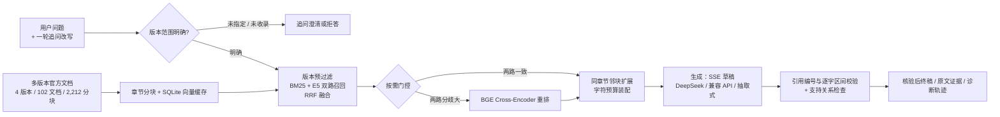

# Knowledge RAG Lab

**能区分文档版本、引用可以逐字核对的技术文档问答系统（RAG）。**

Knowledge RAG Lab 以 FastAPI 多个历史版本的中文官方文档为知识库。回答会附上文档、版本和逐字原文引用；用户没有说明版本时系统先追问，证据不足时直接拒答。检索、重排、上下文装配和引用核验都用显式 Python 实现，每一步都能单独诊断和评测。


<sub>上图为本地抽取式模式录屏，没有调用模型。另有一段真实 DeepSeek 流式生成的录屏：[deepseek-streaming-20261102.gif](docs/assets/deepseek-streaming-20261102.gif)。</sub>

## 目录

- [背景与问题](#背景与问题)
- [主要特性](#主要特性)
- [系统架构](#系统架构)
- [实验结果](#实验结果)
- [快速开始](#快速开始)
- [配置](#配置)
- [API](#api)
- [评测与复现](#评测与复现)
- [项目结构](#项目结构)
- [局限性](#局限性)
- [版本历史](#版本历史)
- [文档](#文档)
- [第三方材料](#第三方材料)

## 背景与问题

技术文档通常有多个版本同时在用，同一个接口在不同版本里的行为可能不一样。通用 RAG 用在这类场景时，常见问题有三个：

1. **混用版本**：召回的片段来自另一个版本，答案看起来合理，实际是错的。
2. **引用不可核对**：模型给出的引用和原文对不上，甚至是编造的。
3. **重排成本高**：Cross-Encoder 能补回一些漏召回的证据，但在 CPU 上每次要多花几秒。

本项目对应的做法是：召回前先按版本过滤；生成后用程序逐字核对引用；用一条无需训练的门控规则决定是否运行重排器。每项设计都在自建的已审核问题集上做了对照实验。

## 主要特性

| 模块 | 实现 |
| --- | --- |
| 版本感知 | 召回前按产品和版本预过滤；版本未指定时先追问，版本未收录时拒答；支持一轮追问补充版本，并按规则改写查询 |
| 混合检索 | BM25 与本地 `multilingual-e5-small`（384 维）两路召回，用 RRF 融合 |
| 按需重排 | 可选 `bge-reranker-base` Cross-Encoder；门控规则根据重排前两路 Top-5 的重合度决定是否调用 |
| 上下文装配 | 扩展同章节的相邻分块，并按字符预算装配；可选合并重叠原文 |
| 可核验生成 | 模型按结论输出引用编号和逐字引文；程序校验引用编号及原文字符区间，再由模型检查引文是否支持结论 |
| 流式交互 | `POST /api/v1/chat/stream`（SSE）：先流式输出未核验草稿，核验通过后替换为终稿；支持取消、心跳和有界队列背压 |
| MCP Server | 基于官方 `mcp` SDK（FastMCP），提供 `list_catalog`、`search_docs`、`ask_docs` 三个工具和分块、文档两类资源 |
| 可复现评测 | 冻结协议并记录哈希，保留原始 JSON 与逐题结果；证据覆盖、答案正确率和拒答行为分开统计 |
| 工程化 | SQLite 向量缓存按模型文件哈希和推理配置隔离；新索引原子切换，构建失败时保留旧索引；提供 Docker 镜像和请求日志关联 |

## 系统架构



核心代码位于 [`app/`](app/)：检索 [`retrieval.py`](app/retrieval.py)、门控 [`budget_reranking.py`](app/budget_reranking.py)、重排 [`cross_encoder.py`](app/cross_encoder.py)、上下文 [`context.py`](app/context.py)、生成与核验 [`generation.py`](app/generation.py)、流式接口 [`streaming.py`](app/streaming.py)、服务编排 [`service.py`](app/service.py)。

## 实验结果

> [!IMPORTANT]
> 以下结果来自自建的单领域（FastAPI 中文文档）开发集，样本量小，**不代表泛化效果**。"证据覆盖"指检索得到的上下文是否包含回答所需的全部标注原文，**不等于答案正确率**。预先划分出的 8 道保留测试题至今没有运行。

**评测数据**：从 55 道候选题中划分出 47 道开发题，全部经过人工审核，其中 41 道可以回答，6 道用于测试追问澄清和超范围拒答。同一组问题不会被拆到不同划分里。数据边界见[数据卡](evaluation/SUPPORT_DATA_CARD.md)。

### 1. 检索策略对照

设置：102 份文档、2,212 个分块，Top-5，邻块扩展，8,000 字符预算。41 题 × 4 种策略 × 3 次重复，三次重复的排序完全一致。

| 策略 | 最终上下文完整证据覆盖 |
| --- | ---: |
| Hashing 向量（工程基线） | 27/41 |
| E5 Dense | 31/41 |
| BM25 | 33/41 |
| **E5 + BM25 Hybrid（RRF）** | **35/41** |
| Hybrid + BGE 全量重排 | 37/41 |

运行方式：本地 CPU 真实执行。报告：[corpus-large-v013.summary.md](evaluation/reports/corpus-large-v013.summary.md)、[CORPUS_LARGE_V013.md](docs/CORPUS_LARGE_V013.md)。

### 2. 预算感知的按需重排

门控规则：稀疏和稠密两路的 Top-5 共同分块数少于 2 时才调用 BGE。规则只读取重排前的排名，不接触标注答案。每组独立执行 3 遍，计时包含门控本身，查询和 BGE 结果都不缓存。

| 策略 | Top-5 完整覆盖 | 最终上下文完整覆盖 | 重排调用率 | P50 延迟 | P95 延迟 |
| --- | ---: | ---: | ---: | ---: | ---: |
| 不重排 | 35/41 | 35/41 | 0% | 60.3 ms | 106.1 ms |
| 全部重排 | 36/41 | 37/41 | 100% | 7.64 s | 13.25 s |
| **按需重排** | **37/41** | **37/41** | **39.0%** | **98.2 ms** | **12.94 s** |

- 重排调用减少 61.0%，最终覆盖与全部重排相同，P50 接近不重排。
- P95 只下降约 2.3%：被触发的查询仍要承担 CPU 重排的秒级延迟。
- 预先登记了 14 个候选阈值，用按主题分组的 5 折交叉验证检查阈值选择，合计只有 35/41，说明这条规则在新问题上能否保持覆盖还没有得到验证。

运行方式：本地 CPU（float32，4 线程）真实执行，不调用付费 API。报告：[REPORT.md](evaluation/reports/budget-reranking-20261106-complete/analysis/REPORT.md) · [逐题结果](evaluation/reports/budget-reranking-20261106-complete/analysis/CASES.md) · [实验设计](docs/BUDGET_RERANKING_20261106.md)。

### 3. 新主题冻结验证

为检查门控规则在没见过的问题上的表现，新编写了 12 道题，覆盖 6 个主题。12 题全部经过人工确认后，先冻结规则和输入，再只执行一次，共 36 条运行。

| 策略 | 最终上下文完整覆盖 | 重排调用 | P50 延迟 | P95 延迟 |
| --- | ---: | ---: | ---: | ---: |
| 不重排 | 11/12 | 0/12 | 43.8 ms | 47.9 ms |
| 全部重排 | 12/12 | 12/12 | 7.39 s | 7.89 s |
| 按需重排 | 12/12 | 4/12 | 49.0 ms | 7.78 s |

这批题规模很小，而且都由助手编写、属于同一领域，结果只说明规则在这 12 题上没有损失覆盖，不能当作广泛的泛化结论。报告：[REPORT.md](evaluation/reports/new-topics-20261109/analysis-complete/REPORT.md) · [逐题解释](evaluation/reports/new-topics-20261109/INTERPRETATION.md)。

### 4. 端到端答案质量（真实模型 + LLM-as-Judge）

设置：102 份文档，E5 + BM25 Hybrid，不重排，Top-5，生成模型为 `deepseek-flash` 并开启支持关系检查；由独立的 LLM-as-Judge（同为 `deepseek-flash`，输出经严格 JSON Schema 校验）评分。

| 指标 | 结果 |
| --- | ---: |
| 可回答题：完整正确 | 36/41（87.8%） |
| 可回答题：核心问题解决 | 37/41（90.2%） |
| 已作答题的忠实度（没有无依据的结论） | 37/37 |
| 证据不足而拒答 | 4/41 |
| 边界题（追问澄清 / 超范围拒答）行为正确 | 6/6 |

Judge 的可靠性单独做了校准：和 11 份人工评分相比，正确性和忠实度判断一致 11/11；另有 12 份助手复核和 3 个人工构造的矛盾负例，分开统计。生成和评审用的是同一个模型，存在自评偏差的风险，人工样本也偏少。报告：[answer-judge-20261102.md](evaluation/reports/answer-judge-20261102.md)。

### 结果口径汇总

| 结果 | 运行方式 | 人工参与 |
| --- | --- | --- |
| 检索策略对照、按需重排、新主题验证 | 本地真实模型（E5 / BGE，CPU） | 题目和证据标注经人工审核 |
| 端到端答案质量 | 真实 DeepSeek API 生成 + LLM 评审 | Judge 用 11 份人工评分校准 |
| 零密钥演示、冒烟评测 | Hashing 向量 + 抽取式回答，不调用模型 | 无，只用于工程验证 |
| Docker 交付 | 本地构建并实测 12 次请求，验证重启后索引保留 | 无；没有云端部署 |

## 快速开始

### 环境要求

- Python 3.11 或更高版本（开发环境为 Windows / Python 3.12）
- 零密钥演示不需要 GPU、模型权重或 API Key

### 零密钥演示

```powershell
python -m venv .venv
.\.venv\Scripts\python.exe -m pip install -e ".[dev]"
.\.venv\Scripts\python.exe -m scripts.serve --demo --bootstrap
```

打开 <http://127.0.0.1:8000>。演示模式使用 BM25 检索和抽取式回答（直接展示证据片段），不调用任何模型。可以先不选版本提一个问题，看系统如何追问；再选择 `0.115.0`，查看带原文出处的证据。

Linux / macOS 下把 `.\.venv\Scripts\python.exe` 换成 `.venv/bin/python`。

### Docker

```bash
docker compose up --build
```

容器以非 root 用户、只读根文件系统运行，端口仅绑定 `127.0.0.1:8000`。验证记录见 [CONTAINER_VALIDATION.md](docs/CONTAINER_VALIDATION.md)。

### 本地语义检索与重排

```powershell
.\.venv\Scripts\python.exe -m pip install -e ".[dev,embedding,reranking]"
.\.venv\Scripts\python.exe -m scripts.fetch_embedding_model   # 固定版本的 multilingual-e5-small
.\.venv\Scripts\python.exe -m scripts.fetch_reranker_model    # 固定版本的 bge-reranker-base（可选）
.\start-semantic.ps1 -Bootstrap            # E5 + BM25 Hybrid，http://127.0.0.1:8016
.\start-semantic.ps1 -Bootstrap -Rerank    # 额外启用 BGE 重排
```

模型版本、文件哈希和资源开销见 [EMBEDDING_V011.md](docs/EMBEDDING_V011.md) 与 [STREAMING_RERANKING_V012.md](docs/STREAMING_RERANKING_V012.md)。

### 接入大模型生成

> [!NOTE]
> 以下模式会调用外部 API 并产生费用。密钥只放在未提交的 `.env` 文件或系统环境变量中。

- **DeepSeek**：设置环境变量 `DEEPSEEK_API_KEY` 后运行 `.\start-semantic.ps1 -Bootstrap -DeepSeek`。
- **OpenAI 兼容接口**（如阿里云百炼）：参考 [`.env.aliyun.example`](.env.aliyun.example) 配置后，依次运行 `scripts.check_models`、`scripts.ingest_support`、`scripts.serve`。
- **Ollama**：模板见 [`.env.ollama.example`](.env.ollama.example)。这种模式尚未实测。

### MCP Server

```powershell
.\.venv\Scripts\python.exe -m pip install -e ".[mcp]"
.\.venv\Scripts\python.exe -m app.mcp_server --demo --bootstrap
```

默认使用 `stdio` 传输。客户端配置示例和真实 `stdio` 子进程的验证记录见 [MCP.md](docs/MCP.md)。

## 配置

所有配置都通过环境变量或 `.env` 设置，完整列表见 [`.env.example`](.env.example)。

| 变量 | 默认值 | 说明 |
| --- | --- | --- |
| `EMBEDDING_PROVIDER` | `hashing` | `hashing` / `local_e5` / `openai_compatible` |
| `RETRIEVAL_STRATEGY` | `hybrid` | `bm25` / `dense` / `hybrid` |
| `RERANKER_PROVIDER` | `none` | `none` / `bge_cross_encoder` |
| `RERANKER_CANDIDATE_K` | `50` | 送入重排器的候选数 |
| `LLM_PROVIDER` | `extractive` | `extractive` / `deepseek` / `openai_compatible` |
| `LLM_VERIFY_SUPPORT` | `true` | 是否让模型检查引文是否支持结论 |
| `CHUNKING_STRATEGY` | `window` | `window` / `sections`（实验均使用 `sections`） |
| `CHUNK_SIZE` / `CHUNK_OVERLAP` | `500` / `80` | 分块长度与重叠字符数 |
| `RETRIEVAL_TOP_K` | `5` | 最终保留的分块数 |
| `CONTEXT_POLICY` | `neighbors` | `neighbors` / `merged_neighbors` |
| `CONTEXT_CHAR_BUDGET` | `16000` | 上下文正文的字符上限 |

## API

启动服务后，交互式接口文档在 `/docs`。

| 方法与路径 | 用途 |
| --- | --- |
| `GET /health`、`GET /ready` | 存活检查；就绪检查（索引非空），不请求模型 |
| `GET /api/v1/catalog` | 查询已收录的产品和版本 |
| `POST /api/v1/documents/text`、`POST /api/v1/documents/upload` | 导入文本或文件（Markdown / TXT / PDF） |
| `GET`、`DELETE /api/v1/documents[/{id}]` | 列出或删除文档 |
| `POST /api/v1/retrieval/search` | 按产品和版本检索 |
| `POST /api/v1/chat` | 问答，返回答案、引用和诊断轨迹 |
| `POST /api/v1/chat/stream` | SSE 流式问答（先草稿，核验后给终稿） |

请求示例：

```json
{
  "question": "前端携带 Cookie 跨域时，allow_origins 可以设为星号吗？",
  "product": "fastapi",
  "version": "0.115.0",
  "top_k": 5
}
```

响应的 `status` 取值为 `answered`、`evidence_only`、`needs_clarification`、`insufficient_evidence` 或 `error`，同时返回 `citations`、`retrieval`、`context`、`trace` 和 `model_trace`（各阶段耗时与 token 用量）。HTTP 响应头 `X-Request-ID` 和 `trace.request_id` 一致，可以用来关联服务端日志；日志里不记录问题正文和认证信息。

## 评测与复现

```powershell
# 工程测试与静态检查
.\.venv\Scripts\python.exe -m pytest
.\.venv\Scripts\python.exe -m ruff check app scripts tests

# 冒烟评测（3 份示例文档 / 6 个问题，只验证流程能跑通）
.\.venv\Scripts\python.exe -m scripts.evaluate --demo --report-name latest

# 离线检索诊断页：逐题比较各策略，查看证据位置、排名和预算损失
.\.venv\Scripts\python.exe -m scripts.diagnose_retrieval --output work/diagnostics/development.json
```

默认测试套件不需要模型权重；本地 E5 / BGE 的集成测试需要先下载权重并显式开启。上面各项实验的完整复现命令：

| 实验 | 复现说明 |
| --- | --- |
| 按需重排 | [REPRODUCE.md](evaluation/reports/budget-reranking-20261106-complete/analysis/REPRODUCE.md) |
| 新主题冻结验证 | [REPRODUCE.md](evaluation/reports/new-topics-20261109/REPRODUCE.md)（包含不加载模型的结果核查） |
| 检索策略对照 / 语料扩容 | [CORPUS_LARGE_V013.md](docs/CORPUS_LARGE_V013.md) |
| 端到端答案评测 | [answer-judge-20261102.md](evaluation/reports/answer-judge-20261102.md) |

评测约定：所有指标都由脚本生成，原始 JSON 保留不做手工修改；保留测试集只在配置冻结后运行。

## 项目结构

```text
knowledge-rag-lab/
├── app/                    # 服务与 RAG 核心链路（检索、重排、上下文、生成、核验、MCP）
│   └── static/             # 网页前端
├── scripts/                # 启动、导入、语料抓取、评测与实验脚本
├── tests/                  # 单元测试与接口契约测试
├── evaluation/
│   ├── support_corpus/         # 34 份文档的语料快照（演示默认使用）
│   ├── support_corpus_large/   # 102 份文档 / 4 版本的扩容语料快照
│   ├── questions.*.jsonl       # 评测问题与证据标注
│   └── reports/                # 实验报告与原始结果
├── docs/                   # 设计说明、实验协议与操作手册
├── sample_data/            # 冒烟测试用示例文档
├── Dockerfile, compose.yaml
└── pyproject.toml
```

## 局限性

- **数据规模**：只覆盖 FastAPI 中文文档这一个领域，开发集 47 题；保留测试集没有运行，所有数字都只是开发集上的结果。
- **评审偏差**：答案评测的生成模型和 Judge 是同一个模型，人工校准样本只有 11 份。
- **重排延迟**：CPU 上的 BGE 重排每次约需数秒，按需门控能降低平均成本，但改善不了 P95。
- **语料完整性**：扩容抓取时有 18 个页面因网络失败没有收录（清单已保留）；中文翻译可能落后于英文原文。
- **服务形态**：单进程本地服务，没有鉴权和多租户；存储为 JSON + SQLite，BM25 每次全量重建，Dense 检索是线性扫描，没有做压测。
- **文档格式**：不支持扫描版 PDF 的 OCR，代码块也没有做结构化解析。

## 版本历史

| 版本 | 日期 | 主要内容 |
| --- | --- | --- |
| v0.16 | 2026-11-09 | 新主题冻结验证（12 题 / 6 主题）与源码导读 |
| v0.15 | 2026-11-06 | 预算感知的按需重排门控与真实计时实验 |
| v0.14 | 2026-11-02 | 端到端答案评测（LLM-as-Judge）、MCP Server |
| v0.13 | 2026-10-28 | 语料扩容至 102 份文档 / 4 个版本，重新对照各检索策略 |
| v0.12 | 2026-10-28 | SSE 流式交互、多轮追问、BGE Cross-Encoder 重排 |
| v0.11 | 2026-10-27 | 本地 E5 语义检索；Docker 交付实测 |
| v0.10 | 2026-10-26 | 问题人工复核工作台；DeepSeek 开发实验 |
| v0.9 | 2026-10-06 | 版本故障实验室：复现跨版本的真实行为差异 |
| v0.6 – v0.8 | 2026-09-12 | 零密钥交付、离线检索诊断工作台、上下文合并与预算配对 |
| v0.1 – v0.5 | 2026-07 – 09 | 原型、评测体系、引用元数据、核验对照 |

每个版本的详细记录、验证快照和已知问题见 [PROJECT_CONTEXT.md](PROJECT_CONTEXT.md)。

## 文档

完整索引见 [docs/README.md](docs/README.md)。常用入口：

- [三分钟演示脚本](docs/SHOWCASE.md)
- [按需重排实验设计](docs/BUDGET_RERANKING_20261106.md)
- [离线检索诊断](docs/RETRIEVAL_DIAGNOSTICS.md)
- [上下文合并与预算](docs/CONTEXT_PACKING.md)
- [版本故障实验室](docs/VERSION_LAB.md)
- [MCP 接入](docs/MCP.md)
- [数据卡](evaluation/SUPPORT_DATA_CARD.md)

## 第三方材料

- 知识库语料来自 [FastAPI](https://github.com/fastapi/fastapi) 官方中文文档（MIT 许可），按固定提交抓取，来源、许可证和文件哈希记录在语料 manifest 中。
- 嵌入模型 [`intfloat/multilingual-e5-small`](https://huggingface.co/intfloat/multilingual-e5-small) 与重排模型 [`BAAI/bge-reranker-base`](https://huggingface.co/BAAI/bge-reranker-base) 均为 MIT 许可，按固定 revision 下载，权重不随仓库分发。
