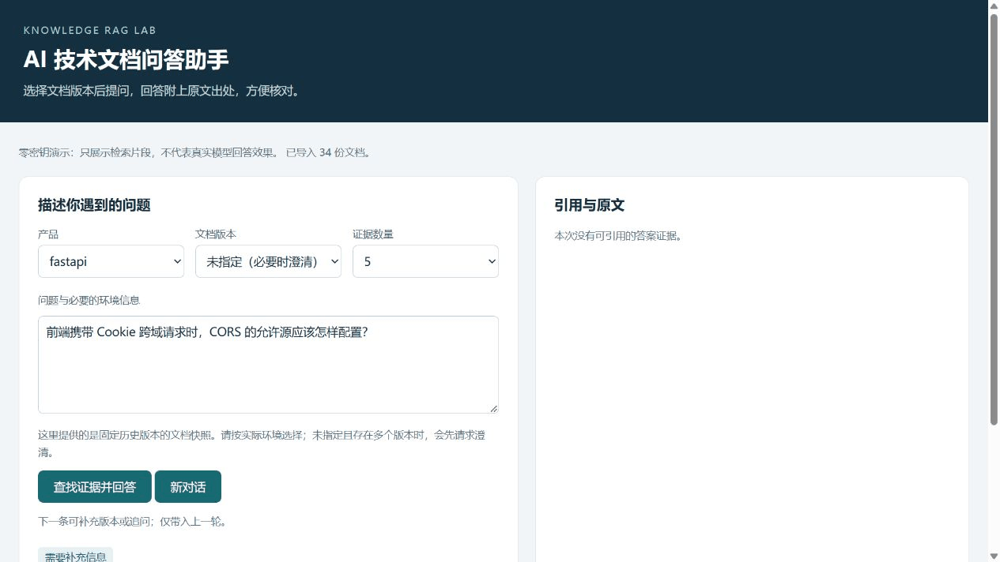
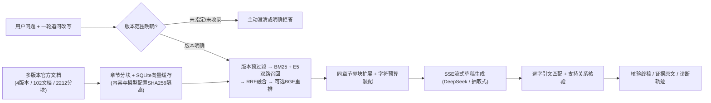
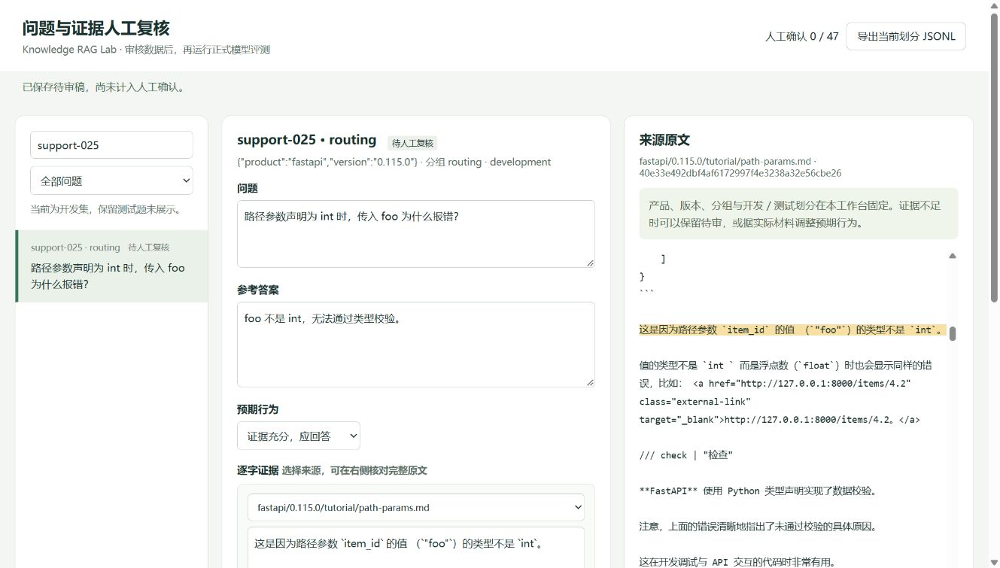
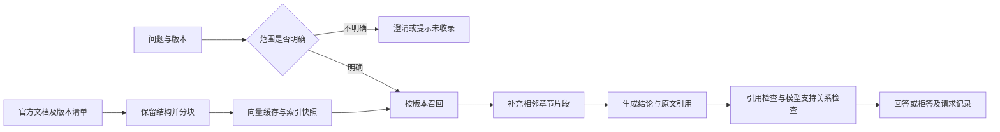

# Knowledge RAG Lab：版本感知的开发者技术支持助手

> **一句话定位：** 面向多版本技术文档的可溯源 RAG 问答系统——基于 4 个版本、102 份 FastAPI 官方文档（2,212 个分块），通过“版本识别与预过滤 → BM25 + E5 双路召回 → RRF 融合 → BGE 重排 → 邻块预算装配 → 逐字引用与支持核验”，从源头避免跨版本内容混用与无据幻觉。



## 核心亮点

- **多阶段版本感知检索链路：** 显式实现“版本识别与召回前预过滤 → BM25 + 本地 `multilingual-e5-small`（384 维）双路召回 → RRF 融合 → `bge-reranker-base` Cross-Encoder 重排 → 同章节邻块扩展与字符预算装配”，支持一轮版本补充与规则查询改写。
- **评测驱动与逐阶段 Bad Case 归因：** 自建 47 道已人工审核开发题（41 道有证据诊断题 + 6 道版本澄清/拒答题），按“版本过滤 → 候选池召回 → Top-K 截断 → 上下文预算”逐阶段归因；在 34 份文档（735 分块）上，Top-5 召回配合邻块扩展的完整证据覆盖率由 BM25 基线 **78.0%（32/41）提升至 E5 Hybrid 87.8%（36/41）、叠加 BGE 重排达 92.7%（38/41，种子 Top-5 为 36/41）**；语料扩容约 3 倍至 **102 份文档（4 个版本、2,212 分块）** 后仍保持 **90.2%（37/41，E5 Hybrid 为 85.4% / 35/41）**，并量化 CPU 重排额外延迟（P50 +8.5s / 扩容后 +11.5s）设计为按需开启（注：上述指标为开发集证据覆盖率，非生成答案正确率）。
- **可信生成与端到端答案评测（LLM-as-Judge）：** 强制模型按结论输出文档、版本与逐字引文，程序校验引用编号与原文字符区间精确匹配，再由模型执行支持关系检查；版本未指定时主动追问澄清，超出收录版本或证据不足时明确拒答。在 102 份文档（2,212 分块）与 47 道已审核开发题上完成真实 `deepseek-flash` 端到端生成与独立 LLM-as-Judge 评测（[评测报告](evaluation/reports/answer-judge-20261102.md)）：41 道可回答题达到 **87.8%（36/41）完整正确率、90.2%（37/41）核心问题解决率与 100%（37/37）已作答忠实度**（另有 4 题安全拒答，零无依据编造），6 道缺版本澄清与超范围拒答边界题准确率 **6/6（100%）**；Judge 经 11 份人工盲审、12 份助手复核与 3 份合成矛盾负例分层校准（一致率均为 100%，并独立检出 `F001` 源文档翻译滞后负例）。
- **SSE 流式交互、MCP 协议接入与工程化交付：** `POST /api/v1/chat/stream` 实现“未核验草稿（`draft`）实时流式输出 → 引用与支持核验后原子替换终稿（`final`）”，支持取消、心跳与有界队列背压；基于官方 `mcp` SDK（`FastMCP`）封装标准 **MCP Server**（暴露 `list_catalog`、`search_docs`、`ask_docs` 工具与 `rag://chunk/{chunk_id}`、`rag://document/{document_id}` 资源，通过真实 `stdio` 子进程端到端验证，可直接接入 Claude Desktop / Cursor，见 [MCP 说明](docs/MCP.md)）；SQLite 向量缓存按模型文件 SHA-256 与推理配置隔离（2,212 分块热重建 100% 命中、零重复编码、0.39s 完成），新索引原子切换、失败保留旧索引；通过本地 Docker 交付实测与 **220+ 项自动化测试**。

## 系统架构



## 快速开始（零密钥 ≤ 4 条命令）

```powershell
python -m venv .venv
.\.venv\Scripts\python.exe -m pip install -e ".[dev]"
.\.venv\Scripts\python.exe -m scripts.serve --demo --bootstrap
# 打开 http://127.0.0.1:8000 体验版本澄清与证据定位（本地 E5 语义检索见 .\start-semantic.ps1）
```

## 文档导航

- **项目全局与面试展示：** [项目上下文与验证档案](PROJECT_CONTEXT.md) · [三分钟演示与面试](docs/SHOWCASE.md) · [开发约定](AGENTS.md) · [实施计划](docs/IMPLEMENTATION_PLAN.md)
- **检索、重排与扩容实验：** [v0.13 扩容语料对照](docs/CORPUS_LARGE_V013.md) · [v0.12 SSE 与 BGE 重排](docs/STREAMING_RERANKING_V012.md) · [v0.11 本地 E5 语义检索](docs/EMBEDDING_V011.md) · [v0.8 上下文合并与预算](docs/CONTEXT_PACKING.md) · [v0.7 离线检索诊断工作台](docs/RETRIEVAL_DIAGNOSTICS.md)
- **生成核验、端到端评测、MCP 与交付：** [端到端答案评测与 Judge 校准](evaluation/reports/answer-judge-20261102.md) · [MCP 服务端接入](docs/MCP.md) · [生成与核验配对对照](docs/GENERATION_COMPARISON.md) · [v0.10 人工复核与 DeepSeek 试跑](docs/EVALUATION_V010.md) · [人工审核交接](docs/HUMAN_REVIEW_HANDOFF.md) · [版本故障实验室](docs/VERSION_LAB.md) · [Docker 容器验证](docs/CONTAINER_VALIDATION.md) · [数据卡](evaluation/SUPPORT_DATA_CARD.md)

---

面向 AI 应用开发实习的可复现工程项目。当前以 FastAPI 官方中文文档为知识域，围绕接口使用、跨域、文件上传、依赖清理、代理和部署问题提供带证据的技术支持。

先阅读 [PROJECT_CONTEXT.md](PROJECT_CONTEXT.md) 和 [AGENTS.md](AGENTS.md)。场景选择及验收范围见 [实施计划](docs/IMPLEMENTATION_PLAN.md)，数据边界见 [数据卡](evaluation/SUPPORT_DATA_CARD.md)。

## v0.12：SSE、追问与Cross-Encoder

网页已改用SSE：实时生成未核验草稿，最终结果经原有引用／支持检查后替换；支持取消、新对话及一轮版本补充／规则查询改写。可选固定`bge-reranker-base`在RRF之后、Top-K之前对50候选重排，`start-semantic.ps1 -Rerank`启用。

本机193项工程测试通过，包含真实E5/BGE集成；实际回环SSE探针通过。47道已审核开发题中41道可诊断题的最终上下文完整覆盖36→38，Top-5完整覆盖36→36；CPU重排额外P50约8.5秒，因此默认关闭。没有新答案质量结论或保留测试。接口、复现及完整取舍见[说明](docs/STREAMING_RERANKING_V012.md)。

2026-10-28发布前完整172项工程测试通过，包含本地E5模型集成。随后本机47道开发问题已由实际人员保存人工确认；已审核快照下重跑四策略三重复492条检索，覆盖和历史排序一致。6份实际模型答案已按用户明确判断完成评分，报告／答案哈希校验通过；该小批开发样本不能代表整体答案正确率或独立测试效果。个人审核记录与此次运行保留本地，当前状态见[项目上下文](PROJECT_CONTEXT.md)；项目展示见[三分钟演示与面试](docs/SHOWCASE.md)，审核操作见[审核交接](docs/HUMAN_REVIEW_HANDOFF.md)。

本机后续已在明确批次授权下完成15道已审核开发题的BM25／E5 Hybrid生成与同答案核验对照：30组成对记录、49次deepseek-flash补全、90,170 tokens，离线重放及调用前上下文一致性通过。17份有效新答案中5份已由用户实际评分，另12份按用户委托完成助手复核；助手判断11份通过、R015有中文语料事实冲突，已保存修正建议。两种评分来源分别记录，整体人工正确率未知；单列的3份原答案／3份明确改错压力测试不能代替自然答案质量。本次复核无新增DeepSeek调用，原始实验及旧评分保持不变。新增工具27项相关离线测试通过，设计与复现见[生成与核验对照](docs/GENERATION_COMPARISON.md)。默认服务、保留测试及公开版本未随该本地实验改变。

2026-10-28复核修订已落地：旧6份与新17份实际答案合并为本机最新材料，R003补充Pydantic版本条件，R015删除错误的headers差异扩展；6道澄清／拒答题追加明确署名的助手理由。原11份人工评分及冻结报告保留，修订稿不继承原人工评分。入口`work/human-review/20261028/CURRENT_REVIEW.md`，详见[审核交接](docs/HUMAN_REVIEW_HANDOFF.md)。后续版本段落中的“待审核”描述保留当时实验状态，不能替代当前本机进度。

2026-10-27补充本地Docker交付实测：实际构建、12次零密钥业务请求、重启后索引与资源清理均通过，最终13项检查及20项相关工程测试通过。复现见 [容器验证](docs/CONTAINER_VALIDATION.md)；E5权重、真实生成与远端CI不在本次容器验证范围。

## v0.11：本地真实语义检索与可复现对照

已接入固定MIT版本的多语言E5-small，实际生成文档和查询的384维向量；本地CPU推理，模型缺失明确失败，模型/配置/文件哈希隔离缓存与索引身份。Hashing保留为独立工程基线。

固定34份官方文档、735分块、Top-5、邻块策略及8000字符上限，完成41道可诊断开发候选×四策略×三重复，共492次检索。最终上下文完整标注覆盖：BM25 32、Hashing 29、E5 Dense 33、E5 Hybrid 36。Hybrid相对BM25改善5题、退化1题、不变35题；完整变化、原文定位和失败排名均保存。候选仍待人工审核，覆盖不是答案正确率，保留测试集未运行。

```powershell
# 模型已下载后：单独建库 / 启动本地语义检索
.\start-semantic.ps1 -BuildOnly
.\start-semantic.ps1
```

打开 <http://127.0.0.1:8016>，默认抽取式展示，不调用生成API。完整安装、固定模型卡、资源成本、实验命令与简历表述见 [v0.11复现说明](docs/EMBEDDING_V011.md)，结果见 [逐题报告](evaluation/reports/semantic-embedding-development-v011.md) / [交互诊断](evaluation/reports/semantic-embedding-development-v011.html)。真实本地HTTP 8项检查通过；模型权重、缓存和私有资料留本地。

## v0.10：人工复核与真实 DeepSeek 开发实验

2026-10-26 已完成一次真实 DeepSeek / BM25 开发试跑和一次固定候选重排对照。使用现有 `DEEPSEEK_API_KEY`，未创建或复制密钥。

- 新增本地问题复核工作台：问题、参考答案和来源原文并排核对；支持修改逐字证据、保存待审稿、人工确认、断点续审和 JSONL 导出。
- 原始候选、产品版本和分组划分保持固定；复核记录绑定问题与语料哈希，拒绝过期页面或其他进程覆盖。默认只展示47道开发候选。
- DeepSeek 从实际模型目录选择可用模型，按供应商接口发送 JSON 请求；记录请求模型、实际响应模型、用量及截断状态。
- 9道未审开发候选完成真实生成／核验配对试跑：13次模型调用、22,147 tokens、0接口或格式错误；导出6份待人工评分答案。
- 根据文档命中但具体证据遗漏的案例，试验对固定 BM25 前20候选做 DeepSeek 重排。41道可回答开发候选中，最终上下文完整覆盖由32题变为37题，5题增加、0题减少；仍有4题未完整覆盖。
- 重排41次调用使用325,022 tokens，SDK调用累计49.212秒。相同的是候选池、Top-K和上下文字符上限，不是实际 token 或总成本。

这些题目全部仍待人工审核；上述覆盖变化不是答案正确率，也不是保留测试集效果。重排目前为独立对照实验，默认服务检索行为未切换。该版本尚未评测真实语义Embedding，v0.11已补本地检索对照。

```powershell
# 不调用模型的人工复核工作台：http://127.0.0.1:8013
.\start-review.ps1

# DeepSeek + BM25 本地问答：http://127.0.0.1:8014；问答会消耗API用量
.\start-deepseek.ps1
```

详细操作与可用简历表述见 [v0.10说明](docs/EVALUATION_V010.md)，查看 [真实试跑](evaluation/reports/deepseek-bm25-development-v010.md)、[重排配对结果](evaluation/reports/deepseek-reranking-development-v010.md) 和 [交互诊断报告](evaluation/reports/deepseek-reranking-development-v010.html)。



## 当前能做什么

- 固定官方文档提交号、文件哈希和许可证，展开同版本的代码示例引用。
- 支持 Markdown/TXT/PDF；保留代码缩进、标题、章节及 PDF 物理页码。
- 支持字符窗口和章节分块，提供 BM25、Dense、RRF Hybrid；产品与版本过滤在召回前应用。
- 有多个文档版本但未指定时先澄清；未收录版本明确拒答。
- 补充同一文档、同一章节的相邻片段，最多 16000 字符上下文。
- 真实模型按结论输出引用和原文，校验引用编号及原文匹配，再由模型检查支持关系。模型核验仍需人工抽查。
- 同一来源在同一版本内更新时替换旧内容；SQLite 缓存未变化的文本向量；新索引失败时旧内容保持可用。
- 页面展示回答状态、实际引用、原文、召回记录、索引指纹与阶段耗时。
- 评测区分文档命中、具体证据覆盖和回答行为，保存原始 JSON、Markdown 及数据/代码指纹。
- 开发集诊断工作台逐题比较三种策略，展示证据范围、实际排名、相邻补充与预算损失，输出独立 HTML 和原始 JSON。
- 可选合并连续重叠上下文，保留原文范围和组成分块，使用相同检索结果与预算上限比较覆盖、重复字符及退化案例。

核心链路保持显式 Python 实现，便于定位分块、召回、证据不足和生成错误。

v0.5 已补充同一答案的核验开关对照、分阶段耗时/token、人工答案复核和报告哈希绑定；当时缺少凭据，v0.10已运行真实 DeepSeek 开发试跑，人工核验效果仍待评分。完整步骤见 [核验实验说明](docs/VERIFICATION_EXPERIMENT.md)。开发问题审核入口为 [47 题复核表](evaluation/review/support-development.md) 或 v0.10 工作台，全部保持待审核。

v0.6 新增一条命令导入并启动、就绪检查、关联请求日志与独立 HTTP 验证。当时采用零密钥开发。该版本73项测试及24次本地HTTP行为检查通过；Docker已于2026-10-27补充本机实测，远端CI仍未触发。详见 [启动与交付说明](docs/DELIVERY.md)。

v0.7 新增离线检索诊断工作台；当轮本机 **89 项测试通过**。已运行 47 道开发候选题，其中 41 道参与证据诊断、6 道拒答或澄清题跳过。查看 [交互报告](evaluation/reports/retrieval-diagnostics-v07.html)、[原始 JSON](evaluation/reports/retrieval-diagnostics-v07.json) 和 [诊断规则与演示步骤](docs/RETRIEVAL_DIAGNOSTICS.md)。原始标注仍待人工审核，未运行测试集或模型 API。

v0.8 新增可追溯的上下文合并与配对预算实验；当轮 **107项测试通过**，合并模式的12次真实HTTP行为检查通过。默认策略仍为 `neighbors`，可用 `--context-policy merged_neighbors` 启动合并模式。详见 [合并规则与复现](docs/CONTEXT_PACKING.md) 和 [配对开发报告](evaluation/reports/context-comparison-v08.md)。该版本验证了工程行为及原文范围覆盖，未验证真实模型回答质量。



## 版本故障实验室

v0.9 新增 [复现与面试演示](docs/VERSION_LAB.md)：对照 FastAPI 0.117.1 与 0.118.0 官方固定文档，在两套隔离环境实跑流式/后台任务的四种资源管理案例。打开启动后的 `/versions`，查看原文范围、提交来源、实际失败与事件顺序。

该版本 **119项测试通过**；八个固定版本/案例组合均符合预期。原始报告见 [JSON](evaluation/reports/version-behavior-v09.json) 和 [脚本派生摘要](evaluation/reports/version-behavior-v09.md)。这是实际框架与模拟资源的行为实验，不是数据库验证或 RAG 回答准确率。原有55题仍待人工复核，真实模型的后续开发实验见v0.10。

## 立即运行零密钥演示

Windows / PowerShell，Python 3.11+。新机器必须重建虚拟环境：

```powershell
python -m venv .venv
.\.venv\Scripts\python.exe -m pip install -e ".[dev]"
.\.venv\Scripts\python.exe -m scripts.serve --demo --bootstrap
```

打开 [本地演示](http://127.0.0.1:8000)。`--demo` 明确使用 BM25 + 抽取式展示，Hashing 只用于本地索引与对照实验，不调用模型 API。先不选版本提交一次问题，验证澄清；再选 0.115.0，查看该版本的证据。页面不会把抽取片段标成真实模型答案。

仓库已包含可校验的文档快照。需要重新下载时运行：

```powershell
.\.venv\Scripts\python.exe -m scripts.fetch_support_corpus
```

17 个主题各含两个历史版本，共 34 个文件；这不是最新文档，也不是 34 个独立业务来源。原有培养管理 PDF 保留在 `evaluation/corpus/`。

## 百炼兼容 API 模式

在未提交的 `.env` 中填写控制台给出的密钥、地域对应的兼容 Base URL 和有权使用的模型名。当前准备的模型名为 `text-embedding-v4` / `qwen-plus`，实际可用性必须由检查命令确认。

本节保留为后续可选供应商配置示例；当前零密钥开发无需填写密钥或开通 API。

```text
DASHSCOPE_API_KEY=在本地填写
DASHSCOPE_BASE_URL=控制台显示的兼容接口地址
EMBEDDING_PROVIDER=openai_compatible
EMBEDDING_MODEL=text-embedding-v4
LLM_PROVIDER=openai_compatible
LLM_MODEL=qwen-plus
LLM_ENABLE_THINKING=false
CHUNKING_STRATEGY=sections
RETRIEVAL_STRATEGY=hybrid
```

依次运行：

```powershell
.\.venv\Scripts\python.exe -m scripts.check_models
.\.venv\Scripts\python.exe -m scripts.ingest_support
.\.venv\Scripts\python.exe -m scripts.serve
```

检查只进行少量模型请求，记录连接及输出格式，不代表效果评测。正式回答包含生成和支持关系检查两次调用。失败只报告异常类型，不打印密钥或原始认证错误。

也支持分别配置 `EMBEDDING_API_KEY/BASE_URL` 和 `LLM_API_KEY/BASE_URL`；Ollama 模式模板见 `.env.ollama.example`，检查脚本为 `scripts.check_ollama`。本轮没有验证 Ollama。

## 评测与复现

零密钥生成检索诊断页面：

```powershell
.\.venv\Scripts\python.exe -m scripts.diagnose_retrieval --output work/diagnostics/development.json
```

直接打开同名 `.html`，按问题、版本、失败类型筛选并切换 BM25/Dense/Hybrid。报告保存分块与证据原文，可离线查看；再次生成需使用新的输出名。默认强制 Hashing，不读取已配置的远程模型进行调用；后续使用真实 Embedding 需显式加 `--configured-embeddings`。详见 [检索诊断说明](docs/RETRIEVAL_DIAGNOSTICS.md)。

比较上下文预算装配，两种策略复用同一检索结果：

```powershell
.\.venv\Scripts\python.exe -m scripts.compare_context --budgets 1200 2400 4800 16000 --output work/context-comparison/development.json
```

该实验比较相同字符上限，不保证实际字符数或 token 相等。完整保留受益、退化和不变的配对题目，不以候选数据自动调整默认策略。

原有三份示例文档、六个问题只用于冒烟测试：

```powershell
.\.venv\Scripts\python.exe -m pytest
.\.venv\Scripts\python.exe -m ruff check app scripts tests
.\.venv\Scripts\python.exe -m scripts.evaluate --demo --report-name latest
```

新场景有 **55 个待人工复核候选问题**，划分为 47 题开发集、8 题测试集。同组问题不跨划分。本轮只使用开发集，不声称已建成正式 benchmark。

```powershell
.\.venv\Scripts\python.exe -m scripts.evaluate --demo `
  --documents evaluation/support_corpus `
  --questions evaluation/questions.support.candidate.jsonl `
  --split development --chunking-strategy sections `
  --top-k 1 3 5 --answers --report-name support-development-hashing

.\.venv\Scripts\python.exe -m scripts.run_support_experiments --demo
```

矩阵比较 300/500/800 字符、window/sections 两种分块策略，以及 K=1/3/5/10。全部结果由脚本生成；记录具体问题、召回范围、配置与指纹。窗口变大、追加相邻片段都会改变证据预算，不能把它们的覆盖率差异直接当作等预算收益。

人工复核入口是 [SUPPORT_REVIEW.md](evaluation/SUPPORT_REVIEW.md)。确认并修订后另存 `evaluation/questions.support.reviewed.jsonl`，填写 `review_status=human_verified`、`reviewed_by`、`reviewed_at`。真实模型开发基线可运行：

```powershell
.\.venv\Scripts\python.exe -m scripts.evaluate `
  --documents evaluation/support_corpus `
  --questions evaluation/questions.support.reviewed.jsonl `
  --split development --require-reviewed --chunking-strategy sections `
  --top-k 1 3 5 --answers --report-name support-real-development
```

冻结配置之后再运行 `--split test`。文档级命中不代表证据命中；回答率不代表正确率；原文匹配和模型判定也不等于人工确认。缺失的答案正确率显示 null，未人工复核的数据和 Hashing 结果不可作为简历效果数字。

本轮 Python 3.12 / Windows 的依赖快照保存在 `requirements-dev.lock`；如需复现依赖，先安装该文件，再执行 `pip install -e . --no-deps`。它是版本快照，不包含包哈希，也不是跨平台部署保证。

## API

接口文档位于 `/docs`。主要接口为：

| 方法与路径 | 用途 |
|---|---|
| GET `/health`、`/ready` | 进程存活与非空索引就绪检查，不请求模型 |
| GET `/api/v1/catalog` | 产品与已收录版本 |
| POST `/api/v1/documents/text` | 文本及可选 product/version 导入 |
| POST `/api/v1/documents/upload` | 文件上传及表单 product/version |
| GET / DELETE `/api/v1/documents`、`/api/v1/documents/{id}` | 列表与删除 |
| POST `/api/v1/retrieval/search` | 按产品和版本召回 |
| POST `/api/v1/chat` | 回答、引用与请求记录 |

```json
{
  "question": "前端携带 Cookie 跨域时，allow_origins 可以设为星号吗？",
  "product": "fastapi",
  "version": "0.115.0",
  "top_k": 5
}
```

问答返回 `status`、`answer`、实际使用的 `citations`、初始 `retrieval`、补充后的 `context` 和 `trace`。状态包括 `answered`、`evidence_only`、`needs_clarification`、`insufficient_evidence`、`error`。引用编号对应上下文顺序，可能不连续。

另返回 `model_trace`，按生成和核验记录 SDK 调用耗时及已知 token，缺失用量为 `null`。`LLM_VERIFY_SUPPORT` 默认 true；`CONTEXT_CHAR_BUDGET` 默认 16000，约束分块正文字符数。核验接口错误或返回格式错误为 `error`，不算正确拒答。

HTTP 响应的 `X-Request-ID` 与问答 `trace.request_id` 一致，可关联到服务端 JSON 请求日志。日志不包含问题正文、认证头或查询参数。

`CONTEXT_POLICY` 默认为 `neighbors`；选择 `merged_neighbors` 时，在预算内合并同一原文范围，合并证据的 `metadata.context_chunk_ids` 指向组成分块。trace 另记录策略、唯一及重复原文字符数，引用保留准确字符范围。普通评测也支持 `--context-policy`，历史报告不会自动改写。

## 运行边界与下一步

当前是绑定 127.0.0.1 的单进程演示服务，没有鉴权或多租户隔离。服务内部对写操作串行化，读请求使用不可变索引快照；不支持多个服务进程或导入脚本同时写同一索引。使用 CLI 导入后需要重启已启动的服务。JSON 存储适合小规模展示，BM25 仍全量重建，Dense 仍线性扫描。

向量缓存按供应商、模型、接口及 `EMBEDDING_CACHE_REVISION` 隔离；本地E5另自动包含固定提交、文件SHA256、输入/截断/推理配置及依赖版本，索引指纹同时绑定namespace。同名远程模型升级时应提高该修订值并重建索引。缓存中可以保留已经删除文档的向量，但删除后其分块不再参与检索。

下一步按v0.11优先清单完成人工问题复核与答案评分，核对真实Dense/Hybrid的改善与退化；再用审核后的开发数据比较生成质量与重排成本，冻结配置后运行保留测试集。扫描PDF的OCR、完整代码块解析、鉴权、多进程一致性、向量数据库与部署压测尚未完成。
