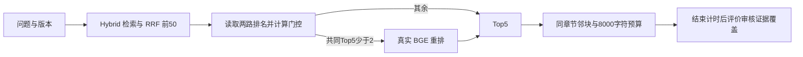

# 预算感知的按需重排

本实验判断是否能只用重排前的检索信号决定何时运行 BGE。三组对照固定同一 E5 + BM25 Hybrid、50 候选、Top-5 和 neighbors / 8,000 字符装配，区别仅为不重排、全部重排和门控后按需重排。

结果入口：[真实运行分析](../evaluation/reports/budget-reranking-20261106-complete/analysis/REPORT.md) · [全部逐题对照](../evaluation/reports/budget-reranking-20261106-complete/analysis/CASES.md) · [两条简历表述](../evaluation/reports/budget-reranking-20261106-complete/analysis/RESUME.md)。原始数据、回放与真实计时独立保留。

## 固定方案与证据范围

- [执行前方案](../evaluation/budget_reranking/plan-20261106.md) 和 [实验配置](../evaluation/budget_reranking/config-20261106.json) 在实现门控与搜索阈值之前保存。
- 已有 Hybrid、BGE、邻块、指标及可复用数据的逐项核查见 [资产审计](../evaluation/budget_reranking/ASSET_AUDIT_20261106.md)。
- 使用冻结 102 份 FastAPI 中文版本文档、4 个版本、2,212 分块，sections 500/80；版本预过滤、两路各 50、等权 RRF k=60、融合后 50。
- 47 道问题来自已有真实人员审核快照；其中 41 道可回答题参与检索指标，6 道澄清/拒答题跳过。8 道既有保留测试不参与本轮。
- 指标是所有审核证据范围的完整覆盖，分别检查种子 Top-5 和最终上下文；文档级命中不代替证据完整性。本轮不生成答案或测答案正确率。
- 本地固定 `multilingual-e5-small@614241f622f53c4eeff9890bdc4f31cfecc418b3`、`bge-reranker-base@2cfc18c9415c912f9d8155881c133215df768a70`，模型文件校验、CPU float32、4 线程、batch=8、max_length=512。没有付费 API 或模型下载。

## 门控与实现

运行入口是 [app/budget_reranking.py](../app/budget_reranking.py)。它只接收已经融合、尚未重排的 SearchHit 列表，不接收评测问题、金标或答案。输入含 `rerank_score` 或 `rerank_rank` 时直接拒绝。

预注册搜索只有两类单特征、14 个阈值：两路 Top-5 共同分块数，以及 RRF 第 1 与第 5 分数的相对间隔。等权 RRF 下，两路都在 Top-5 的块必然进入融合后 Top-50，因此共同分块数能由现有候选排名直接恢复，不需要再执行稀疏/稠密检索。

冻结的规则为：**两路 Top-5 共同分块数 < 2 时执行 BGE**。开发标签用于离线选择阈值；运行分支只看排名。该规则的预算含义是开发分布上的触发比例，不是对任意流量的硬性调用配额。



`BudgetAwareReranker` 提供与现有 `RAGService.reranker` 一致的接口，可显式替换既有 BGE 包装；本轮实验通过同样的检索与上下文组件真实执行，服务默认设置未切换。

```python
from app.budget_reranking import BudgetAwareReranker, GatePolicy

# service 已使用 Hybrid，候选数 50；existing_bge 是已加载的本地 BGEReranker。
service.reranker = BudgetAwareReranker(existing_bge, GatePolicy("overlap", 2))
```

离线选择与分组验证在 [app/budget_evaluation.py](../app/budget_evaluation.py)。它与运行门控分离。主选择约束保留全量重排每道最终完整覆盖题，并且不损失不重排的最终完整题、Top-5 数量不低于不重排；可行规则取最少调用。另列 25%/50%/75%/100% 预算前沿。

5 折 group_id 内部验证只在训练折选择阈值，验证折评分，仍属于开发诊断。开发集此前已有多轮实验记录；本轮不把开发结果或内部验证包装为独立测试成绩。

## 从已有本地资源复现

从项目根目录运行。模型需已按原有 E5/BGE 说明下载；实验不会自动下载或回退到 Hashing。每次使用全新的输出目录与运行目录，不能覆盖本轮保存的文件。

```powershell
# 1. 回放全部阈值，分组内部验证，并冻结所选规则。
.\.venv\Scripts\python.exe -X utf8 -m scripts.experiment_budget_reranking prepare `
  --output-dir evaluation/reports/budget-reranking-REPRO `
  --run-dir work/experiments/budget-reranking-REPRO

# 2. 每组每次都重新编码查询、检索，并按实际分支调用 BGE；共 369 条。
.\.venv\Scripts\python.exe -X utf8 -m scripts.experiment_budget_reranking execute `
  --output-dir evaluation/reports/budget-reranking-REPRO `
  --run-dir work/experiments/budget-reranking-REPRO

# 3. 独立重算覆盖、矩阵和延迟，再生成分析；无模型调用。
.\.venv\Scripts\python.exe -X utf8 -m scripts.report_budget_reranking `
  --experiment-dir evaluation/reports/budget-reranking-REPRO `
  --run-dir work/experiments/budget-reranking-REPRO `
  --output-dir evaluation/reports/budget-reranking-REPRO/analysis

# 4. 需要 ReportLab 4.4.9；本轮使用已提供的独立 Python 运行时，无新增下载。
# 新环境可安装可选依赖 .[plots]；图表只读保存的 JSON。
& $ragFigurePython -X utf8 -m scripts.plot_budget_reranking `
  --experiment-dir evaluation/reports/budget-reranking-REPRO `
  --analysis-dir evaluation/reports/budget-reranking-REPRO/analysis

# 可选 PNG：使用本地已有 Node 和 sharp；SVG 本身已是完整图表。
& $ragFigureNode scripts/rasterize_budget_plots.cjs `
  evaluation/reports/budget-reranking-REPRO/analysis $ragSharpModule
```

`$ragFigurePython`、`$ragFigureNode` 和 `$ragSharpModule` 是本机已有的绘图运行时及 sharp 模块绝对路径。Codex 可用 `load_workspace_dependencies` 获取；精确的本轮本机命令另保存在结果目录的 `REPRODUCE.md`。

初始化、模型校验、冷建库和每组一次暖机单列；真实计时含门控和版本可用分块筛选，不含金标评分与写盘。每组 41 题×3 次，逐题轮换执行顺序；P50/P95 为所有 123 次执行的线性插值分位数。重复不增加独立题数，本机串行计时不代表并发服务能力。

若进程异常结束，保留原目录。最初两次失败启动（66条前缀、一次建库）排除；第三次167条严格顺序前缀保留，依据 [恢复补充](../evaluation/budget_reranking/recovery-amendment-20261106.md) 在新目录用 [补齐脚本](../scripts/resume_budget_measurement.py) 只执行202个缺失键，形成完整369条矩阵，不按指标选取样本。前缀副本、哈希、每段启动和逐行计时段标签均保存；第二重复跨段，报告单列逐段分位数与时序偏差。正常一次复现仍使用上面的原始 prepare/execute 命令。

## 后续独立审核包

[审核入口](../evaluation/budget_reranking/independent-review-20261106-final/REVIEW.md) · [12 道候选](../evaluation/budget_reranking/independent-review-20261106-final/questions.candidate.jsonl) · [助手检查](../evaluation/budget_reranking/independent-review-20261106-final/assistant-checks.jsonl) · [空白人工记录](../evaluation/budget_reranking/independent-review-20261106-final/human-review.pending.jsonl)。

这些是规则冻结后准备的 6 个新文档主题、0.117.1/0.118.0 版本候选，全部 `unreviewed`；助手逐字检查为 `assistant_checked`，真实人工确认 **0/12**。原文快照、许可证、范围坐标、文件哈希和生成器源码一同保存。候选没有检索运行或答案评分，不能计入本轮证据覆盖。

实际人员还需确认问题与范围、参考答案和证据是否充分，以及与已有开发题的语义重复。之后保持规则固定，注册一次性独立验证，再执行；如果用它继续调参，就应把它转为开发材料。原有 8 道保留测试保持独立。
