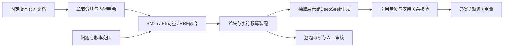

# 三分钟演示与面试

## 要解决的问题与架构

同一框架不同版本可能给出不同处理方式，命中文档也可能遗漏真正回答问题的证据。系统保存版本、定位和实际上下文，支持逐题诊断和人工确认。

## 演示顺序

1. 用`./start-semantic.ps1`启动已下载模型的本地E5模式，默认抽取展示，不调用生成API。说明模型版本与配置参与缓存和索引身份，缺失时明确失败。
2. 提交带版本的问题，检查原文、引用范围和最终上下文；说明召回前版本过滤与上下文预算的作用。
3. 打开`evaluation/reports/semantic-embedding-development-v011.html`，展示Hybrid改善5题、退化1题和其余35题；这些是41道未审开发候选上的标注覆盖，不能作为答案正确率。
4. 打开人工审核工作台及已有DeepSeek开发报告。演示问题、答案、证据、模型用量如何关联，说明审核尚未完成。

## 应能解释的取舍

- 保留显式检索与装配链路，能区分版本过滤、文档命中、证据进入Top-K和最终上下文，便于定位失败。
- Hashing是独立工程基线；E5是实际运行的语义模型，384维、本地CPU、固定模型文件和推理配置。
- 34文档／735分块，固定41道可诊断开发候选、四策略、三重复，共492条检索；重复排序稳定不等于语义正确。
- 原始报告、候选审核与派生评分分开，人工判断绑定输入哈希，防止源文件变动后沿用旧评分。
- Docker交付验证含12次业务请求和重启／清理；E5容器路径、生产部署、远端CI和正式答案效果不在这一验证范围。

2026-10-28完整172项工程测试通过，包含本地E5集成。真实模型开发试跑、重排及语义检索是不同实验，各自见原始报告，不混算。
