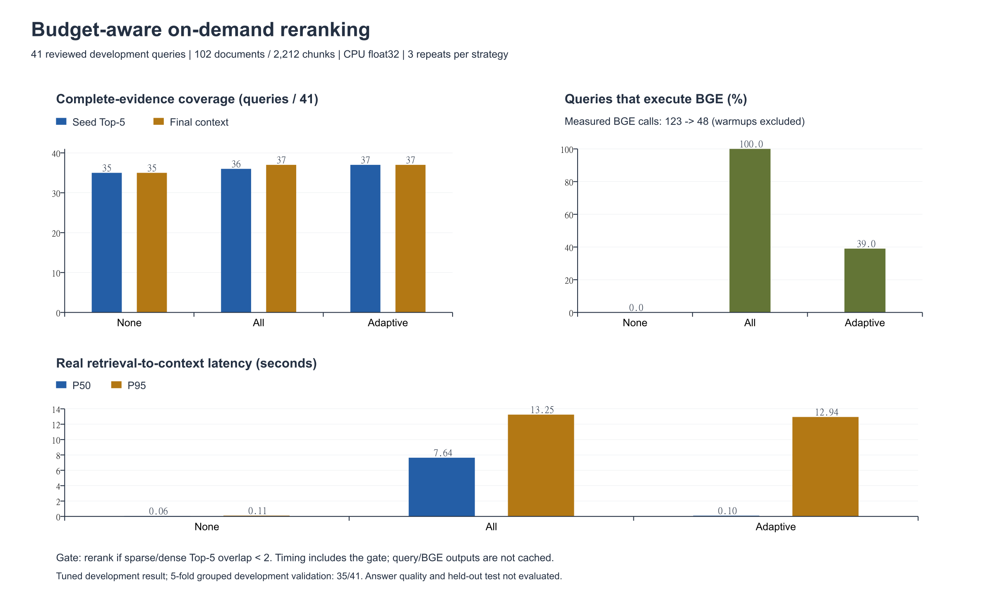
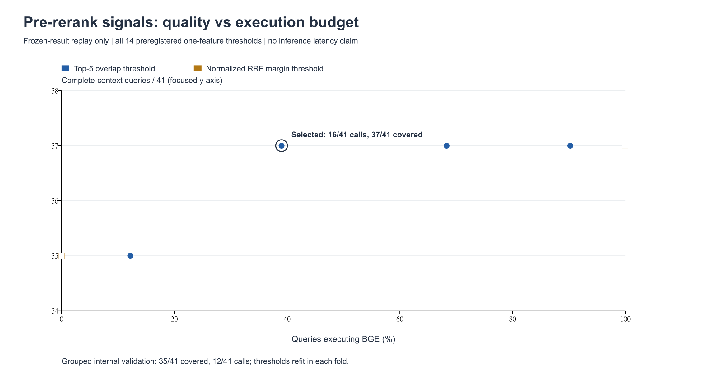
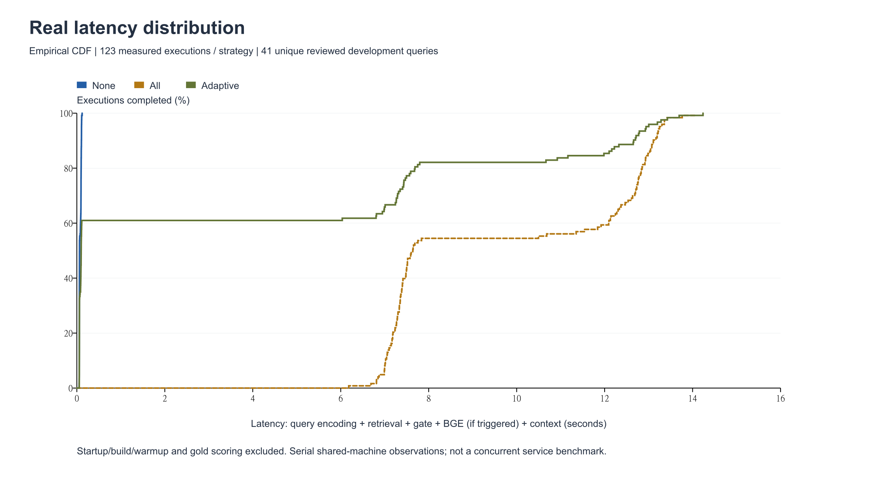

# 预算感知的按需重排：真实本地执行结果

在 41 道已审核开发题上，按需策略触发 16/41 次重排，最终完整证据覆盖 37/41（全量重排 37/41），BGE 调用与打分对数减少 61.0%。这是调参开发集上的检索结论。

按主题分组的 5 折内部验证仅 35/41，未保留两道覆盖增益。当前规则可作为成本实验结果，尚不足以宣称在未见问题上保持覆盖；服务默认配置保持原值。

## 三组真实对照

固定 102 份文档 / 2,212 分块；E5+BM25 等权 RRF，50 候选，Top-5，neighbors / 8,000 字符。
47 道开发题中 41 道可回答题参与，6 道澄清/拒答题单列跳过。覆盖指所有审核证据字符区间均完整纳入。

| 策略 | Top-5 完整覆盖 | 最终上下文完整覆盖 | 重排触发率 | 真实 P50 | 真实 P95 | 真实均值 |
|---|---:|---:|---:|---:|---:|---:|
| 不重排 | 35/41 | 35/41 | 0/41 (0.0%) | 60.30 ms | 106.06 ms | 75.00 ms |
| 全部重排 | 36/41 | 37/41 | 41/41 (100.0%) | 7638.88 ms | 13246.17 ms | 9737.72 ms |
| 按需重排 | 37/41 | 37/41 | 16/41 (39.0%) | 98.22 ms | 12940.29 ms | 3833.29 ms |



相对全部重排，P50 减少 98.7%、P95 减少 2.3%、均值减少 60.6%。调用减少不能直接等同于延迟同比减少；按需策略仍有约四成慢请求，因此尾延迟的节约通常有限。

## 阈值选择：缓存回放，不能作为真实计时

执行前方案见 `evaluation/budget_reranking/plan-20261106.md`；14 个单特征阈值均在下表。选择标准是保留 all 的每道最终完整题且不损失 none 的最终完整题，Top-5 数量不低于 none，再取最少调用。

| 特征 | 阈值 | 触发/41 | Top-5 | 最终上下文 | 相对全量最终损失 | 满足主约束 |
|---|---:|---:|---:|---:|---|---|
| overlap | 0 | 0 | 35 | 35 | support-029, support-034 | 否 |
| overlap | 1 | 5 | 35 | 35 | support-029, support-034 | 否 |
| overlap | 2 | 16 | 37 | 37 | 无 | 是 |
| overlap | 3 | 28 | 36 | 37 | 无 | 是 |
| overlap | 4 | 37 | 36 | 37 | 无 | 是 |
| overlap | 5 | 41 | 36 | 37 | 无 | 是 |
| overlap | 6 | 41 | 36 | 37 | 无 | 是 |
| margin | 0 | 0 | 35 | 35 | support-029, support-034 | 否 |
| margin | 0.002 | 0 | 35 | 35 | support-029, support-034 | 否 |
| margin | 0.005 | 0 | 35 | 35 | support-029, support-034 | 否 |
| margin | 0.01 | 0 | 35 | 35 | support-029, support-034 | 否 |
| margin | 0.02 | 0 | 35 | 35 | support-029, support-034 | 否 |
| margin | 0.05 | 0 | 35 | 35 | support-029, support-034 | 否 |
| margin | 1.01 | 41 | 36 | 37 | 无 | 是 |

`overlap` 的条件为共同 Top-5 分块数 < 阈值；`margin` 为 (RRF第1分−第5分)/第1分 <= 阈值。冻结规则为 overlap < 2。候选的两路排名和 RRF 分在重排前已有；运行门控不接收题号、金标、参考答案或 BGE 分。开发标签只用于离线阈值选择。
最少调用只针对这 14 个预注册规则；margin 网格在 0.05 与 1.01 之间没有中间点，未试探更细阈值，因此不能据此断言 margin 信号无效或当前规则全局最优。



| 调用预算上限 | 选中规则 | 实际触发 | 最终完整覆盖 | Top-5 |
|---|---|---:|---:|---:|
| 25% | {'family': 'overlap', 'threshold': 0} | 0/41 | 35/41 | 35/41 |
| 50% | {'family': 'overlap', 'threshold': 2} | 16/41 | 37/41 | 37/41 |
| 75% | {'family': 'overlap', 'threshold': 2} | 16/41 | 37/41 | 37/41 |
| 100% | {'family': 'overlap', 'threshold': 2} | 16/41 | 37/41 | 37/41 |

25% 预算未能保留全部收益；50% 预算下所选规则满足开发集质量约束。预算是开发分布上的调用比例，并非任意线上流量的硬性配额或逐请求截止时间。

## 分组内部验证与适配偏差

固定按 group_id 排序后轮转分配 5 折，只在训练折选阈值，在验证折评分。此处仍是开发集回放，没有真实计时或独立测试。历史开发结果此前已被多次查看，因此本轮也不构成严格盲测。

| 折 | 验证主题 | 训练选中规则 | 验证题数 | 触发 | Top-5 | 最终上下文 | 相对全量遗漏 |
|---|---|---|---:|---:|---:|---:|---|
| 0 | background, middleware, workers | {'family': 'overlap', 'threshold': 2} | 7 | 2 | 7 | 7 | 无 |
| 1 | cors, query, yield | {'family': 'overlap', 'threshold': 2} | 14 | 5 | 12 | 12 | 无 |
| 2 | dependencies, response | {'family': 'overlap', 'threshold': 0} | 7 | 0 | 4 | 4 | support-029, support-034 |
| 3 | docker, routing | {'family': 'overlap', 'threshold': 2} | 4 | 1 | 4 | 4 | 无 |
| 4 | errors, upload | {'family': 'overlap', 'threshold': 2} | 9 | 4 | 8 | 8 | 无 |

跨折合计：触发 12/41，Top-5 35/41，最终 35/41。门控从少数收益题学到的阈值不稳定，低重合也不必然意味着重排有收益；后续应优先补充独立主题与更丰富困难样本，保持规则固定后验证，而不是继续对这 41 题增加特征和阈值。
本次两道收益题恰好都在验证折 2，该折训练数据没有重排增益正例，最少调用目标因此选择 overlap < 0，即从不重排。这个缺口直接反映收益正例稀少时选择不可靠，并不证明所有未见问题都没有收益。未根据该结果重排分组或修改主规则。

## 收益、成本与错误归因

完整逐题表见 [CASES.md](CASES.md)，含全部三组覆盖与证据首个完整排名；带实际上下文和原文范围的错误档案见 [errors.json](errors.json)。

| 问题 | 触发 | overlap | none/all/adaptive 首个完整候选排名 | none/all/adaptive Top-5 | none/all/adaptive 最终 |
|---|---|---:|---|---|---|
| support-006 | True | 0 | 7/24/24 | 0/0/0 | 0/0/0 |
| support-009 | False | 2 | 5/10/5 | 1/0/1 | 1/1/1 |
| support-013 | True | 0 | 29/6/6 | 0/0/0 | 0/0/0 |
| support-020 | True | 0 | None/None/None | 0/0/0 | 0/0/0 |
| support-026 | False | 3 | 21/6/21 | 0/0/0 | 0/0/0 |
| support-029 | True | 1 | 20/1/1 | 0/1/1 | 0/1/1 |
| support-034 | True | 1 | 23/1/1 | 0/1/1 | 0/1/1 |

support-029、034 是两道最终覆盖收益题，均被触发；support-009 的全量重排种子退化被门控避开，全量策略原先能由邻块补回，故三组最终上下文在该题均完整。

support-006 重排后完整证据仍在第 24 名，013 与 026 在第 6 名，020 的完整证据仍在融合后 50 池外。门控只决定是否重排，不修复候选池缺失或重排本身的排序失败；本轮不改变候选大小或 Top-K。

触发的 16 道题中，仅 2 道带来最终完整覆盖增加，其余 14 道仍有重排成本但该指标不变。因此当前门控有节约，但对重排收益的识别仍粗糙。新增最终覆盖损失以 transitions 原始记录为准：

```json
{
  "adaptive_vs_none_top_complete": {
    "gained": [
      "support-029",
      "support-034"
    ],
    "lost": []
  },
  "adaptive_vs_none_context_complete": {
    "gained": [
      "support-029",
      "support-034"
    ],
    "lost": []
  },
  "adaptive_vs_all_top_complete": {
    "gained": [
      "support-009"
    ],
    "lost": []
  },
  "adaptive_vs_all_context_complete": {
    "gained": [],
    "lost": []
  }
}
```

## 计时边界与复现

每组 3 次重复、共 123 次执行，三组合计 369 条原始记录。逐题轮换顺序，每组独立编码查询与检索，按需组独立执行门控，并只在触发时真正调用 BGE。文档索引在内存中复用；查询向量与 BGE 结果不缓存。真实总时间包含门控、版本可用分块筛选和上下文装配，评分及日志写盘不计入。模型加载/文件校验、冷建库与每段各组一次暖机单列，共排除 6 次暖机；各段数据在 real.json/measurement_segments。
三组复用驻内存索引和已加载模型；本轮节约的是重排推理调用与打分对数，未证明常驻模型内存减少。

线性插值 P50/P95 取每组全部执行的经验分布，重复仍只有 41 个独立问题。这是共享本机 CPU 上的串行暖态观测，文档准备及轻量脚本工作可能共享 CPU；无并发压测或生产 SLA 结论。本轮 torch 为 CPU 构建，未使用 CUDA，未修改或操作另一项目的实验目录及进程。

按需门控 P50/P95：0.0603/0.1324 ms。实际计时阶段 BGE 调用：all=123、adaptive=48；打分对数 6150→2400（不含暖机）。



逐条排序不稳定 0；与冻结回放排序差异 0，覆盖差异 0，门控决策差异 0。

独立重算 738 项逐次证据完整性检查、核对三组分位数与试验矩阵，787 份既有文件保护哈希通过。检索结论在此范围可复核；携带开发集调参和内部验证不稳定的限制使用。

复现命令见 [REPRODUCE.md](REPRODUCE.md)。逐次记录在上级 `real.trials.jsonl`，回放阈值、冻结选择和 group-validation 分开存档。

## 逐重复计时

| 重复 | 策略 | P50 (ms) | P95 (ms) |
|---:|---|---:|---:|
| 1 | 不重排 | 96.57 | 107.82 |
| 1 | 全部重排 | 12815.69 | 13357.23 |
| 1 | 按需重排 | 104.24 | 13282.51 |
| 2 | 不重排 | 57.99 | 106.06 |
| 2 | 全部重排 | 7478.32 | 13302.18 |
| 2 | 按需重排 | 96.97 | 12659.73 |
| 3 | 不重排 | 57.47 | 60.34 |
| 3 | 全部重排 | 7328.21 | 7601.38 |
| 3 | 按需重排 | 58.85 | 7590.88 |

## 中断记录与分段测量

本表包含第三次执行前缀 167 条，以及新进程补齐的 202 条，合计完整预定矩阵 369 条。前缀逐字副本和 SHA256 保留并逐条比对，没有按结果剔除或重测。冻结 selection 哈希相同，没有重新选阈值。

前两次失败启动（66 条前缀、一次建库中断）另存原目录且排除。第三次退出原因与退出码不可恢复。按恢复补充仅执行缺失键，重新建库和暖机；冷启动不计入热请求分位数。第二重复跨两段，个别配对存在中断间隔，观察到的延迟可能受重启与背景负载影响。各段题目组成也不同，以下分段表用于审计，不用来推断策略间因果性能差异。恢复段的静态环境沿用源段，available_ram_before/background_cpu_percent_before 未重新采样，不据此宣称恢复时无后台负载。额外失败启动开销不能算成策略节约。

| 计时段 | 策略 | 执行数 | P50 (ms) | P95 (ms) |
|---:|---|---:|---:|---:|
| 1 | 不重排 | 56 | 96.27 | 108.58 |
| 1 | 全部重排 | 56 | 12798.74 | 13375.82 |
| 1 | 按需重排 | 55 | 104.64 | 13325.82 |
| 2 | 不重排 | 67 | 57.37 | 60.33 |
| 2 | 全部重排 | 67 | 7302.36 | 7652.70 |
| 2 | 按需重排 | 68 | 58.87 | 7647.61 |

## 后续独立验证

已在规则冻结后准备 12 道候选、6 个新文档主题及原文审核包，来自 0.117.1 / 0.118.0。12 道均为助手拟题、unreviewed；逐字与来源检查为 assistant_checked，真实人工确认 0/12。未运行新候选检索或答案评分。实际审核需补充语义重复、参考答案充分性与证据完整性检查。原有 8 道保留测试未读取题文、未调参、未运行。

下一步是实际人员审核后，保持本轮规则固定进行一次独立验证，优先判断两道开发收益能否扩展到新主题；若不能，应接受简单信号不足的结论，考虑离线学习收益预测或缩减候选池的独立实验。对 P95 敏感的场景还需分别验证较小 BGE 候选池或独立设备，本轮没有相关收益结论。

本轮生成答案 0、付费 API 0、答案正确率未测。不能将以上覆盖或节约数字写成端到端问答准确率。
