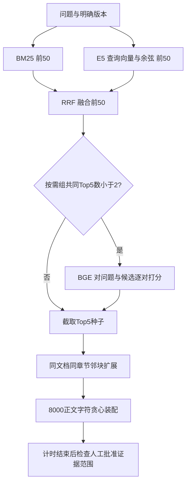

# 从一条查询读懂检索链路

阅读顺序：本页 → `REVIEW.md` → `REPRODUCE.md` → `INTERVIEW.md`。先理解数据如何流动，再看历史数字。本轮的新增功能是准入和固定验证工具，服务默认策略仍为不重排。

本轮不生成答案。服务的生成、逐字引文验证和支持关系核验在上述链路之后，不能把检索覆盖成绩当成那几步的正确率。

|阶段|实际文件与关键函数|输入 → 输出|读代码时回答|
|---|---|---|---|
|读取与分块|[corpus.py](../../../app/corpus.py) `read_documents`；[evaluate.py](../../../scripts/evaluate.py) `load_corpus`；[chunking.py](../../../app/chunking.py) `TextChunker.split`|带清单的版本文档 → sections 500/80块，保留原文字符范围和元数据|为什么审核坐标按加载后的`.strip()`文本，而非文件原始字节？|
|BM25|[tokenization.py](../../../app/tokenization.py) `tokenize`；[retrieval.py](../../../app/retrieval.py) `BM25Retriever.index/search`|英文词、汉字及相邻汉字二元组 → 候选与`sparse_rank`|IDF基于全102文档索引统计；版本过滤发生在候选打分时，不能说每版本独立重建IDF。|
|E5|[local_embeddings.py](../../../app/local_embeddings.py) `LocalE5Embedding._encode/embed_query/embed_documents`；`DenseRetriever.search`|`query: `问题向量与`passage: `块向量 → 余弦排名`dense_rank`|384维、掩码均值池化、L2归一化；CPU float32，512 tokens右截断。为什么查询与文档前缀不同？|
|RRF|[retrieval.py](../../../app/retrieval.py) `HybridRetriever.search`|两路各50 → 等权RRF前50，保留两路排名|`1/(60+dense_rank)+1/(60+sparse_rank)`，缺失一路只计另一路；不用原始BM25分数加余弦。|
|门控|[budget_reranking.py](../../../app/budget_reranking.py) `retrieval_signals`、`GatePolicy.triggers/decide`、`BudgetAwareReranker.rerank`|尚未BGE打分的RRF候选 → 是否执行BGE|共同Top5为0或1时触发，为2时跳过；少于2个候选时直接跳过。函数不接收题号、答案或金标。|
|BGE|[cross_encoder.py](../../../app/cross_encoder.py) `BGEReranker.rerank`|问题和每个候选组成文本对 → logit降序排名|batch8、max_length512；保留RRF `score`，另写`rerank_score/rerank_rank`。logit不是概率。相同logit保持原顺序。|
|上下文|[context.py](../../../app/context.py) `context_candidates`、`_boundary`、`expand_context`|Top5种子 → 同文档、同章节、同版本的前后各一个邻块 → 预算内上下文|先尝试全部种子，再尝试邻块；去重按块ID，超预算整块跳过。500/80是分块参数，8000是正文字符预算，均不是token预算。|
|真实服务|[service.py](../../../app/service.py) `RAGService.answer/_search`|查询与版本 → 澄清/拒答，或检索、可选重排、装配、生成|生产式入口还会版本澄清和一轮改写；本轮评测直接使用已明确版本的问题，不加入改写变量。|
|本轮固定验证|[validate_new_topics.py](../../../scripts/validate_new_topics.py) `prepare/check/freeze/verify_protocol/execute`；[report_new_topics.py](../../../scripts/report_new_topics.py) `run_models/verified_cases/report`|候选与独立人工记录 → 冻结协议 → 三组真实执行 → 独立重算报告|旧开发脚本拒绝test，本轮不把test伪装成development；新入口仅接收这12个固定ID。|

例如，一个块的Dense排名1、BM25排名5，RRF分约为`1/61+1/65=0.03178`；另一个仅Dense排名1的块为`1/61≈0.01639`。两路排名一致会强化该块，但不能证明它包含所有必要证据。门控用的是集合重合数量，不是这两个分数的绝对大小。

两路共同Top5可以从当前RRF前50恢复，是等权、k=60条件下的性质：双路都前5的块最少得`2/65`，高于任何单路块最高的`1/61`，且最多只有8个其他双路块可能排在它前面。更换融合权重后不能直接沿用这个保证。

向量缓存只缓存文档编码；[vector_cache.py](../../../app/vector_cache.py) `CachedEmbedding.embed_query`每次重新编码查询。对照的三组也分别重新检索、真实执行所需BGE，不能把全量组的BGE分数拿来模拟按需组延迟。

判断“已理解”的最小操作：

1. 用005题，在代码中指出版本过滤、RRF截断、门控判断和8000字符装配的位置，并描述每步的数据类型。
2. 手算共同Top5数量为1和2时的分支；解释为什么BGE不能找回融合后50池外的证据。
3. 解释“Top5不完整但最终完整”：邻块补回；解释“同文件命中但仍不完整”：命中段落没有覆盖必要字符区间。
4. 运行不加载模型的`check`；解释缺审核为何必须停在模型前。完成`practice/README.md`的小练习。

能自己解释以上四项，再尝试复现。仅阅读导读或执行已有命令不能当作独立掌握算法实现。
